# The Shooting Star Addition

An **unofficial**, fan-made addon for [The Shooting Star [Demo]](https://www.curseforge.com/minecraft/mc-mods/the-shooting-star-demo)
by rimuru_dev. It adds two new skills to the Stellar Remote: **SA-01 · Halley**, a comet called down onto your
crosshair, and **SA-02 · Luna**, which brings the moon itself down, leaving a moon of edible moon cheese with a
molten heart in a huge crater. On the remote they come after The Shooting Star's own skills. Their codenames are
their own series, SA (Shooting star Addition), so they never clash with the SS numbers of The Shooting Star's own
skills, whatever it adds.

**Download:** [The Shooting Star Addition on CurseForge](https://www.curseforge.com/minecraft/mc-mods/the-shooting-star-addition)

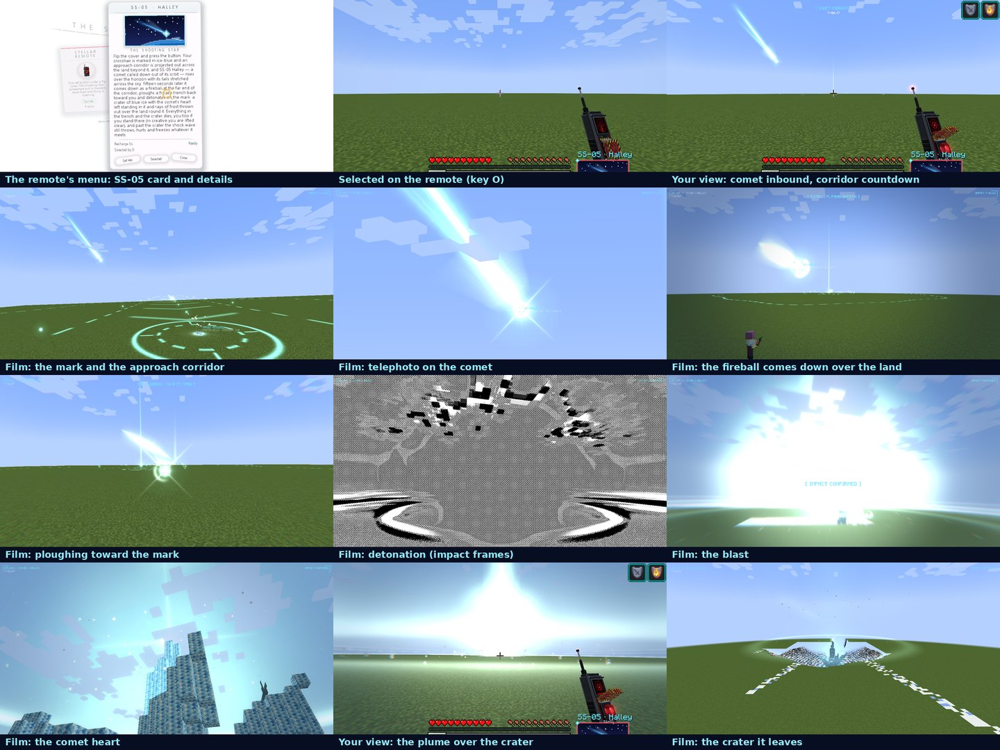

> **Compatibility:** this is the **NeoForge, Minecraft 1.21.1** version, for **The Shooting Star [Demo] 1.3.3, 1.3.4,
> 1.4.0, 1.4.1, 1.4.2 and 1.4.3** (one jar for all of them). There are also Forge and NeoForge 1.20.1 (`forge-1.20.1`
> branch), Forge 1.21.1 (`forge-1.21.1`), Fabric 26.3 (`fabric-26.3`), Fabric 1.21.11 (`fabric-1.21.11`), Fabric
> 1.21.1 (`fabric-1.21.1`) and Fabric 1.20.1 (`fabric-1.20.1`) versions. See
> [Will it work with future versions?](#will-it-work-with-future-versions-of-the-shooting-star) below.

## Halley

Flip the cover and press the button. Your crosshair is marked in ice-blue and an approach corridor is projected
across the land beyond it. A comet rises over the horizon with its tails stretched across the sky, hits the atmosphere
as a fireball, touches down at the far end of the corridor, ploughs a frozen trench back toward you and detonates on
the mark — leaving an icy crater with the comet's glowing heart standing in it, and rays of frost thrown out over the
land round it.

- **The sky goes dark as it comes in**: stars come out, the band of the galaxy, an aurora, and the comet blazes
  across them with its tails, lighting up the air round it. The fireball outshines the stars as it comes down, the
  blast lights up the night, and then the air fills with ice: a pale haze with a halo, sun dogs and a light pillar
  round the sun (or the moon), clearing as the crystals settle.
- **You can't miss it**: outside the cutscene the comet is drawn bigger, and an arrow at the edge of the screen points
  at it while it's out of view.
- **Works with shader packs** (Iris, e.g. Complementary): with one on, Halley paints its comet and sky onto textures
  and draws them the way the pack expects, and the dark sky becomes the pack's own night: the sky's clock races through
  a dusk into the night as the comet comes in, and on through a dawn after the impact. Only what you see changes, never
  the world's actual time.
- Pieces break off the comet and burst in the sky, the fireball sheds sparks and throws lens flares, ice is thrown
  out of the crater on long arcs, glowing cracks race across the land, a wall of snow rides the shock front, and the
  comet heart shines a beam into the sky.
- Joins the Stellar Remote like the built-in skills: its own key (**O** by default), menu card, sliders and description, HUD
  card, cooldown and recharge display.
- Its own cutscene (skippable with the remote's cutscene key), with impact frames, flashes and camera shake in the
  remote's style, and the remote's cover, button and screen animate for it.
- Thirteen new sounds, and two new blocks: the **Comet Heart** and the **Frozen Comet Trail** (mine them with a pickaxe to take them home).
- Everything in the trench and the crater is erased, the way the remote's other skills erase their strike zones (you
  too if you stand there; in creative you are lifted clear). Past the crater, the shock wave throws, hurts and
  freezes whatever it meets.
- **It permanently changes the land.** Back up worlds you care about, as with the original mod.

| | | |
|---|---|---|
| 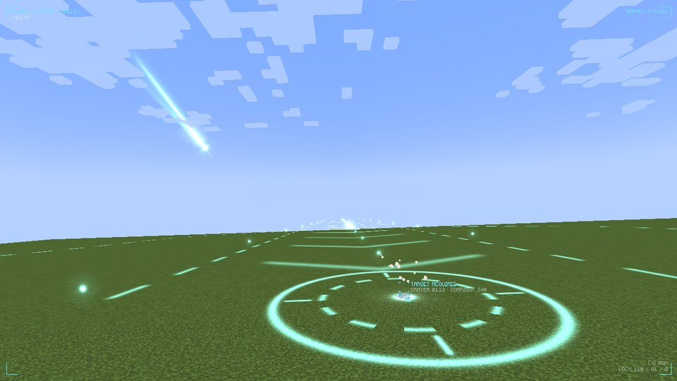 | 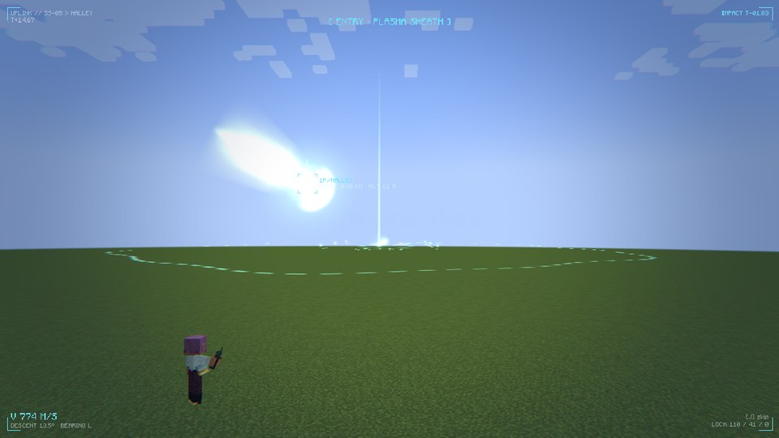 | 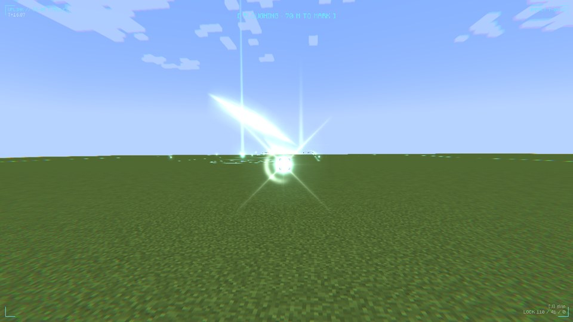 |
| 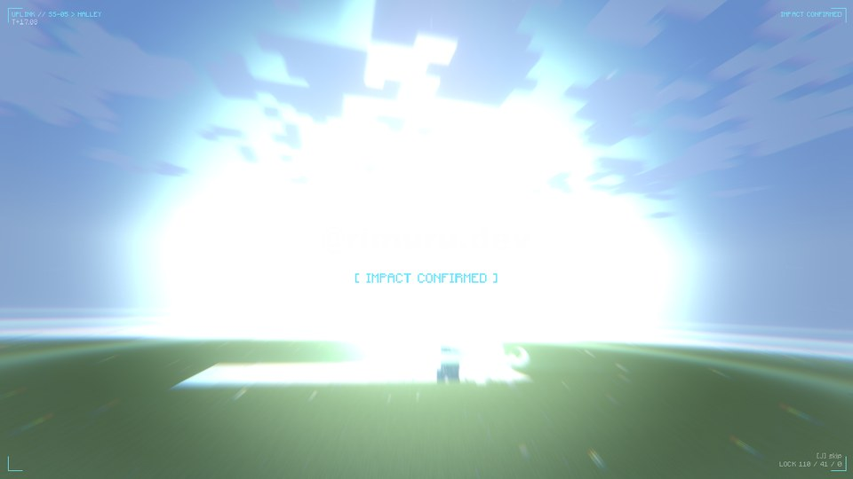 | 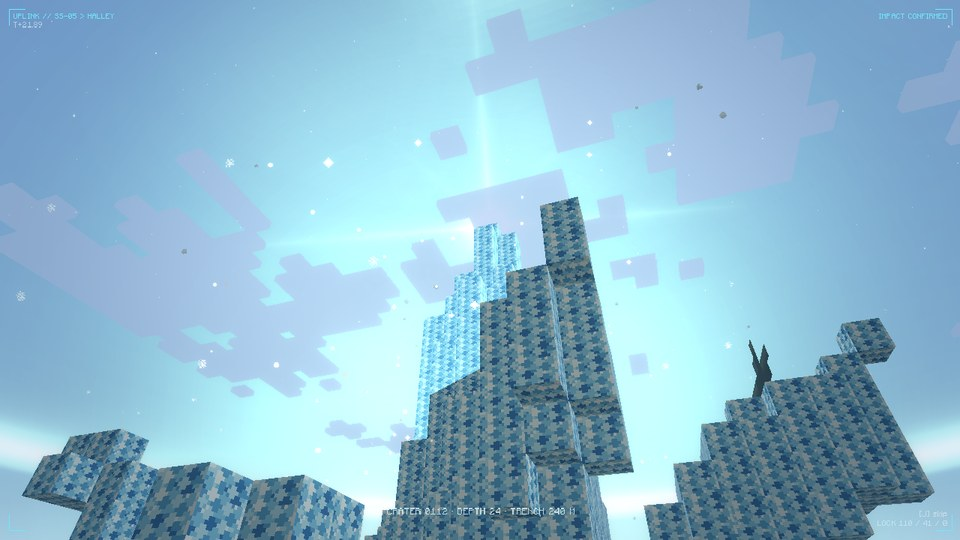 | 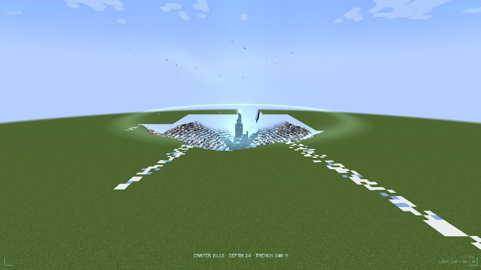 |
| 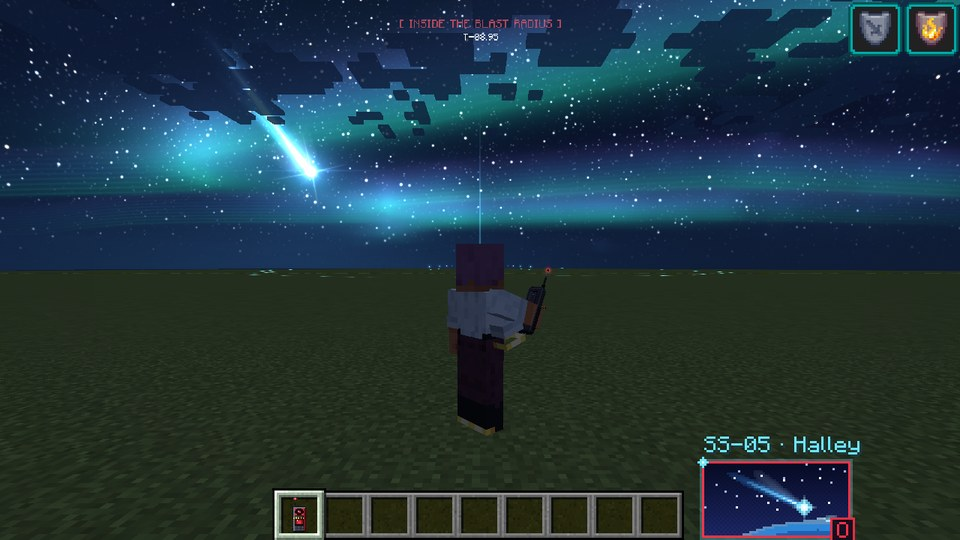 | 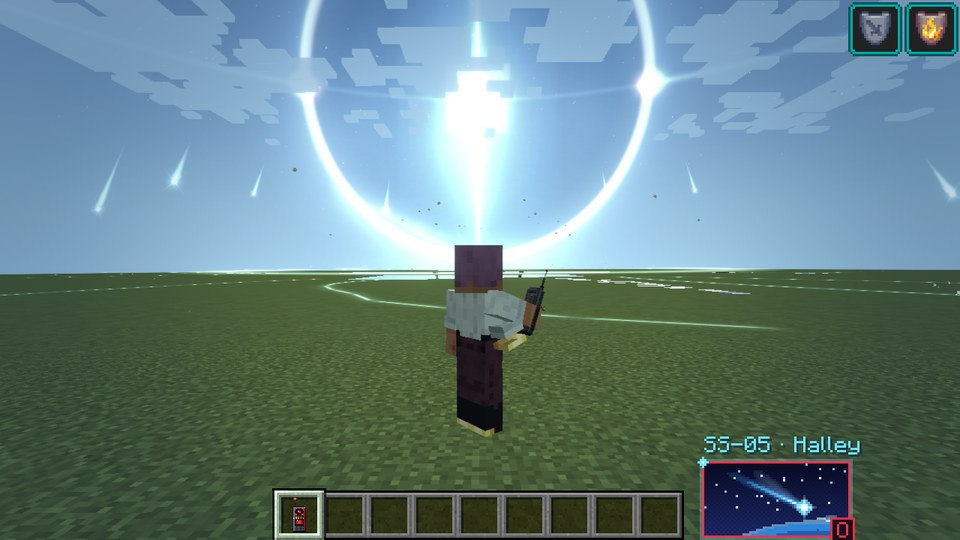 | 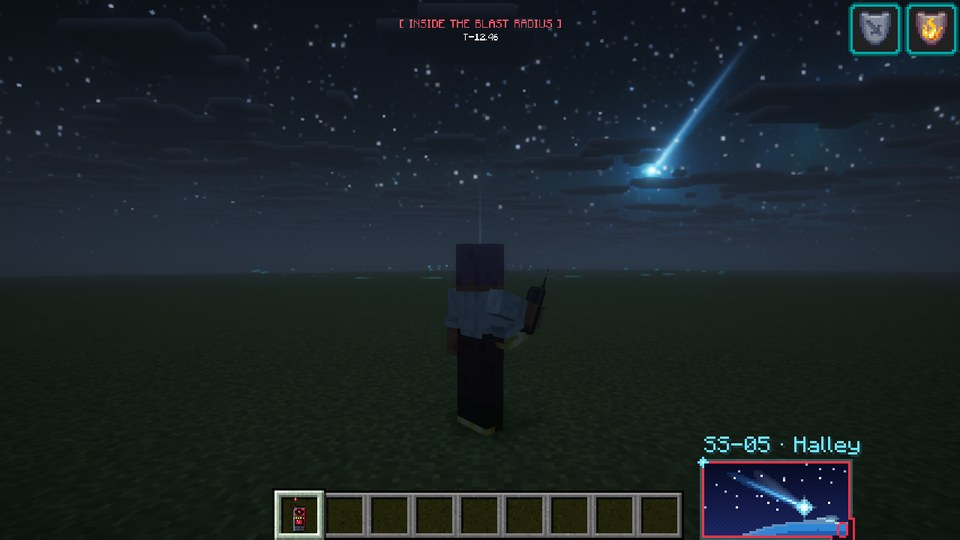 |

## Luna

Flip the cover and press the button: **EARTH SYSTEM SHUT DOWN**, and the sky falls to night (like Halley's). The moon, right where it hangs in your
sky, shudders and cracks open along glowing molten seams, leaves its place and falls onto your crosshair, slowly at
first and then faster and faster, growing until it fills the sky. It burns through the atmosphere in a shroud of fire,
hits the ground in a white flash and a shock ring, blasts a crater more than twice its own width out of the land and
drives deep into it, the crust buckling up against it, and comes to rest there with most of it buried: a whole moon of
**moon cheese**, with one block of **molten moon cheese** at its very centre.

- Works by day or night (the sky turns to night for it; only what you see changes, never the world's time). Not where there is no moon, like the Nether.
- The crater: a wide bowl dug deep round the moon, burnt black and still glowing near it, with veins of molten rock
  across its floor, a band of lava where moon and floor meet, and a ragged rim of upturned crust at its edge.
- Fissures tear out across the land all round the crater (like Gungnir's cracks), lumps of moon and crust rain down
  far beyond it, and the shock wave throws, burns and hurts further still.
- Its own key (**N** by default), menu card, sliders, cooldown (120 s), cutscene (skippable), sounds and alarm.
- Everything in the crater is erased; past it, the shock wave throws, burns and hurts whatever it meets.
- **Moon cheese** (and **holey moon cheese**, the cheese's eyes, scattered all through the moon): right-click a block to place it, right-click the air to eat it. It's as good as a golden carrot, and being cheese it clears your effects like milk.
- **Molten moon cheese**: eat it for **500 hearts** and **Strength 255** for 10 minutes (Molten Might), and a full hunger bar with full saturation (it clears your other effects first, like all moon cheese).
- **Any size**: the moon, crater and shock wave are server settings, from a pebble to a monster (see below),
  and every cast can be 0.1× to 10× that with the remote's power slider.
- **It permanently changes the land.** Back up worlds you care about.

| | | |
|---|---|---|
| 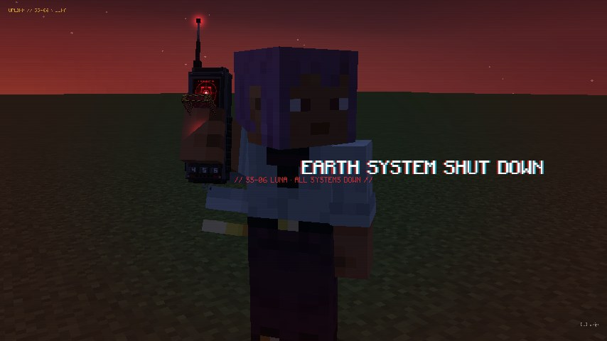 | 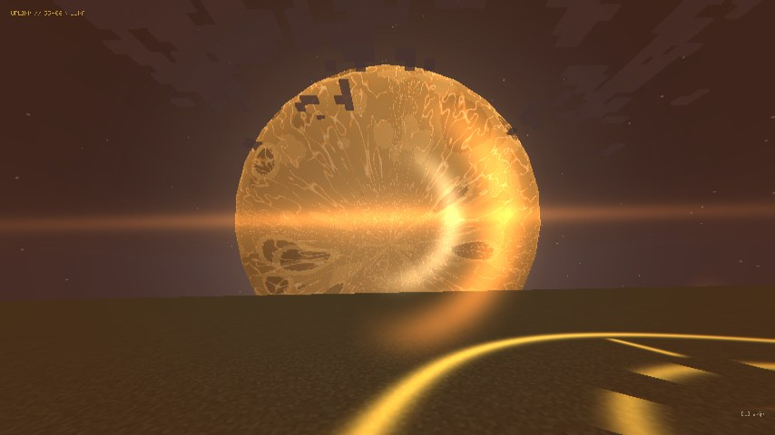 | 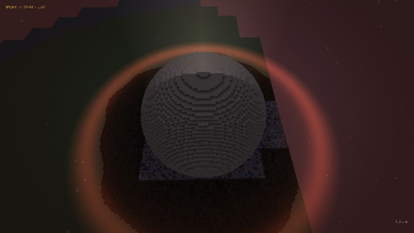 |

## Sliders

Halley and Luna have the same three sliders as The Shooting Star's own skills, under them in the remote's menu
(**H**), and they work the same way:

- **Power**: the whole strike from **0.1× to 10×** as big. For Halley that's the comet, its trench and the crater; for
  Luna, the moon and its crater (the config's sizes are 1×). The cutscene scales with it.
- **Damage**: each hit from **2 up to ∞**. At ∞ (the default), whatever it hits is erased.
- **Speed**: the whole skill, cutscene and all, from **0.3× to 3×** as fast.

Big strikes are heavy on the game: with The Shooting Star 1.4.2 or newer, the menu warns you above 3× for Halley and
2× for Luna. The values are each player's own (the remote keeps them with its own skills' in
`config/shooting_star_demo_skills.properties`), and the server checks them against these ranges.

## No cooldown (optional)

Off by default. Set `no_cooldown = true` in the `[stellar_remote]` section of
`config/shooting_star_addition-common.toml` and every skill on the Stellar Remote — The Shooting Star's own as well as
Halley and Luna — can be cast again straight away, for every player in that world or on that server. The remote's menu
(**H**) shows a note in its corner saying whether it's on. Be careful with this: it lets anyone chain the most
destructive skills back to back.

## Installing

1. Minecraft **1.21.1** with **NeoForge 21.1.x**.
2. **The Shooting Star [Demo]** 1.3.3, 1.3.4, 1.4.0, 1.4.1, 1.4.2 or 1.4.3 (its NeoForge file, e.g.
   `the-shooting-star-demo-1.4.3-neoforge.jar`).
3. This addon's jar ([CurseForge](https://www.curseforge.com/minecraft/mc-mods/the-shooting-star-addition))
   in the same `mods` folder. On a server, it goes on the server **and** on every player's client.

In game: hold the Stellar Remote, press **O** for Halley or **N** for Luna (or pick them in the remote's menu, **H**),
aim at the ground and right-click. The keys can be changed in Controls or from the remote's menu like the others.

## Settings — `config/shooting_star_addition-common.toml`

| Section  | Setting                    | Default | What it does |
|----------|----------------------------|---------|--------------|
| skill    | `cooldown_seconds`         | 60      | Recharge time (the remote's own skills use 60). |
| skill    | `reach`                    | 420     | How far away the crosshair can place the mark. |
| impact   | `trench_length`            | 240     | Length of the trench ploughed toward the mark. |
| impact   | `trench_width`             | 30      | Width of the trench where it meets the crater. |
| impact   | `trench_depth`             | 22      | Depth of the trench. |
| impact   | `crater_radius`            | 56      | Radius of the crater; everything inside dies. |
| impact   | `crater_depth`             | 24      | Depth of the crater. |
| impact   | `blast_reach`              | 2.6     | Shock wave reach, in crater radii (throws, hurts, freezes). |
| world    | `carve_terrain`            | true    | `false` = the strike only hurts creatures, the land is untouched. |
| world    | `leave_comet_heart`        | true    | The glowing heart crystal and the frozen trail down the trench. |
| world    | `frost_rays`               | true    | Rays of snow painted out from the crater. |
| safety   | `evacuate_creative_caster` | true    | Lift a creative-mode caster out of the crater first (Halley and Luna). |

Luna and moon cheese, in the same file:

| Section          | Setting            | Default | Range     | What it does |
|------------------|--------------------|---------|-----------|--------------|
| moonfall         | `cooldown_seconds` | 120     | 1-3600    | Recharge time. |
| moonfall         | `reach`            | 420     | 32-1024   | How far away the crosshair can place the mark. |
| moonfall         | `require_night`    | false   |           | `true` = it refuses by day. |
| moonfall_size    | `moon_radius`      | 48      | 2-200     | Radius of the moon (96 blocks across). |
| moonfall_size    | `impact_radius`    | 110     | 4-320     | Radius of the crater, out to the crest of its rim; everything inside dies. |
| moonfall_size    | `rim_height`       | 9       | 0-96      | How high the crater's rim stands over the land (the slabs leaning on the moon reach most of that over the crater's floor). |
| moonfall_size    | `buried_percent`   | 70      | 0-90      | How much of the moon's height ends up driven down into the crater. |
| moonfall_size    | `blast_reach`      | 3.0     | 1.0-6.0   | Shock wave reach, in impact radii. |
| moonfall_size    | `chunks_per_tick`  | 8       | 1-64      | How fast the crater and moon are cut and built (huge moons take a while). |
| moonfall_world   | `carve_terrain`    | true    |           | `false` = purely visual, only creatures are hit. |
| moonfall_world   | `molten_core`      | true    |           | The block of molten moon cheese at the moon's centre. |
| moon_cheese      | `molten_hearts`    | 500     | 1-512     | Hearts while Molten Might lasts. |
| moon_cheese      | `molten_strength`  | 255     | 1-255     | Strength level it gives. |
| moon_cheese      | `molten_minutes`   | 10      | 1-120     | How long it lasts. |

The Stellar Remote itself, in the same file:

| Section          | Setting            | Default | What it does |
|------------------|--------------------|---------|--------------|
| stellar_remote   | `no_cooldown`      | false   | `true` = no cooldowns at all, for every skill on the remote (The Shooting Star's own too) and every player. Be careful with this. |

Updating from 1.3: `impact_radius`, `rim_height` and `buried_percent` replace Luna's old `crater_radius`,
`crater_depth` and `sink_percent`, so the new, deeper moonfall takes its new defaults even with an old config file.

The server's values are sent with every strike, so every client films exactly the crater the server cuts.

## Looks — `config/shooting_star_addition-client.toml`

Each player can set these for themselves; they only change what you see.

| Setting          | Default | What it does |
|------------------|---------|--------------|
| `sky`            | true    | The sky goes dark while the comet comes in, and hazy with ice after the impact. |
| `darken_land`    | true    | The land dims under that dark sky, so the comet's light stands out. |
| `extra_effects`  | true    | Fragments, sparks, ice from the crater, cracks, the shock wall, the heart's beam, glittering air. |
| `world_flashes`  | true    | The whole world lights up for an instant at touchdown and impact. Turn off if flashing light bothers you. |
| `comet_marker`   | true    | The arrow at the edge of the screen pointing at the comet while it's out of view. |
| `shader_packs`   | AUTO    | How it's drawn with a shader pack: `AUTO` switches to the shader-pack way whenever Iris has a pack on, `ALWAYS` uses it all the time, `NEVER` doesn't (the comet and the sky then won't show under a shader pack). |

## Will it work with future versions of The Shooting Star?

Not without an update of this addon. Since 1.4.0, The Shooting Star is obfuscated: the names inside its code are
scrambled (`a`, `b`, `c`...) and change with every release. It has no official way for other mods to add skills, so
this addon attaches to its internals by those names. It carries a separate attachment for each version of The
Shooting Star it knows, and uses the one for the version you have:

- This version works with **The Shooting Star 1.3.3, 1.3.4, 1.4.0, 1.4.1, 1.4.2 and 1.4.3** (and 1.4.0A, which is 1.4.0).
  With any other version the game says so when it starts, instead of crashing.
- When The Shooting Star updates, wait for the next update of this addon. It adds the new version and keeps the old
  ones, so you can update the two mods in either order.
- On the remote, Halley and Luna come after The Shooting Star's own skills, whatever it adds, and keep their own
  codenames (SA-01 and SA-02), so a new built-in skill never renumbers them.
- If something it attaches to has really changed, the addon doesn't crash your game: it switches its skills off, logs
  why, and tells server operators in chat.
- **If The Shooting Star changes its mod id** (for example when it stops being a demo), this addon won't load until
  it is updated.

- **Other mod loaders and Minecraft versions** each need their own build: this one is NeoForge 1.21.1; there are
  also Forge 1.20.1, Forge 1.21.1, Fabric 26.3, Fabric 1.21.11, Fabric 1.21.1 and Fabric 1.20.1 versions.


## Plans

This is version 1.4. If people enjoy it and there's support for it, I'll keep it updated for new versions of The
Shooting Star and keep improving it: more skills for the Stellar Remote, balancing and polish from your feedback,
and versions for other loaders and Minecraft versions if there's demand. Bug reports, ideas and feedback are very
welcome in the issues.

---

## For developers

### Building

Requires JDK 21. Put The Shooting Star's jars in `libs/`, one for every version the addon should support (see
`libs/README.txt`), then:

- `./gradlew build` → `build/libs/shooting_star_addition-<version>.jar`, for all of them
- `./gradlew runClient` / `./gradlew runServer` → a dev game with the addon and the newest of them
- `./gradlew runProdClientTest -PtssTest=1.4.0 -Dss05.clienttest.skill=halley` → the release jar in a game with that
  version's real jar (see `src/clienttest`)

### When The Shooting Star updates

Since 1.4.0 The Shooting Star is obfuscated, with different names in every release. `compat/tss/` (the only code
that touches it) is written against its readable names, those of 1.3.x, and the build (`gradle/tss.gradle`, tools in
`tools/tss/`) does the rest:

- it compiles and runs against a readable copy of the newest jar in `libs/`, made with a mapping;
- `tssPack` makes the release jar: for **every** jar in `libs/` it maps `compat/tss/` to that version's real names,
  checks every reference against that real jar (the build fails if one doesn't exist there), and puts that copy in the
  jar as `compat/v1_4_1/` etc. At run time `compat/StarBridge` picks the copy for the version that is loaded
  (`compat/TssVersion`), and `compat/TssMixins` lets only that copy's mixins apply. The mod's dependency range is made
  from the versions in `libs/`.

Mappings are made on your own machine and kept out of git (`libs/mappings/`): the repository never carries a
de-obfuscation map of The Shooting Star.

1. Put the new jar in `libs/` **next to** the old ones (one jar per version; a re-upload under the same version
   number, like 1.4.0A, replaces its jar).
2. `./gradlew tssMappings` matches the newest jar against the version before it (made readable with its own mapping)
   and writes `libs/mappings/<name>.tiny`, with a `.report.txt` of what it couldn't match (what's new in the update,
   and anything that changed). Nothing `compat/tss/` uses should be in the report.
3. `./gradlew build`. It compiles against the new version and checks every version in `libs/`.
4. **Compile errors** are in `compat/tss/` only, where something really changed: each helper is a one-line wrapper at
   the bottom of `compat/tss/TssLink.java`; the skills are `HalleySkill.java`/`MoonSkill.java`, the spells
   `HalleySpell.java`/`MoonSpell.java`, the effects `client/*.java`. If the old versions need the old code, the
   change has to work with both (the build checks all of them); the rest of the addon only sees `compat/StarLink`.
5. Test each version: `./gradlew runProdClientTest -PtssTest=<version> -Dss05.clienttest.skill=halley` (and `moon`).
   The log should say `Attaching to The Shooting Star <version> through dev.ss05.halley.compat.v...` and
   `SA-01 · Halley (Halley) joined the Stellar Remote as skill #N`. If it says "couldn't attach", the remote's skill
   list (`SkillSet`) changed shape: `TssLink.install()` finds the fields it needs by their types.
6. **Smaller things that may stop without breaking anything** — optional mixins that switch themselves off if their
   target moved:
   - the remote's cover/button/screen not animating for Halley and Luna → `compat/tss/mixin/RemoteRendererMixin`
     (`strikeTime`);
   - no overlay of theirs on the cutscene → `compat/tss/mixin/FxManagerMixin` (`renderFilmHud`);
   - the no-cooldown note missing from the remote's menu → `compat/tss/mixin/WhiteSpaceMixin` (`render`); the
     `no_cooldown` option not clearing cooldowns → `compat/tss/mixin/CastingMixin` (`syncCooldowns`);
   - the caster's arm not raising (vanilla target, very unlikely to change) → `compat/mixin/PlayerModelMixin`;
   - the land not dimming under the dark sky (vanilla target, very unlikely to change) → `compat/mixin/ClientLevelMixin`;
   - with a shader pack on, the sky not going to night (vanilla target, very unlikely to change) →
     `compat/mixin/ClientLevelTimeMixin`.
7. **A new built-in skill takes the O or N key** → change `DEFAULT_KEY` in `world/HalleyInfo.java` or
   `world/MoonInfo.java`. The codenames need nothing: SA-01 and SA-02 are a series of their own
   (`world/Codenames.java`), so they never clash with the remote's SS numbers.
8. To drop an old version, take its jar out of `libs/`.

### Changing the skill

| To change… | Look in |
|---|---|
| Sizes, cooldown, what it leaves behind | `config/shooting_star_addition-common.toml` (defaults in `HalleyConfig.java`) |
| The timeline (when it is sighted, enters, touches down) | `HalleyPlan.java` — film, sounds and server all follow it |
| Luna (the moonfall), moon cheese | see [docs/SS-06-LUNA.md](docs/SS-06-LUNA.md) (design and code map) |
| What it does to the world | `world/HalleyStrike.java` (block palettes at the top) |
| Name, colour, default key | `world/HalleyInfo.java`; description and key name in `assets/shooting_star_addition/lang/en_us.json` |
| The look: colours, comet size, tails | top of `client/render/CometVisuals.java`; shapes in `halley_glow.fsh` |
| The extras: fragments, ice from the crater, cracks, shock wall, beam | top of `client/render/CometExtras.java` |
| The sky: when it darkens, the aurora, the haze | `sky()` in `client/HalleyFx.java` (timing); `halley_sky.fsh` (the look) |
| Shader packs (Iris) | `client/render/ShaderPacks.java` (when), `GlowAtlas.java` (the painted shapes), `paint()` in `client/sky/HalleySky.java` |
| Sounds, particles, screen effects, HUD | `client/HalleyFx.java`, `client/HalleyHud.java` |
| The cutscene | `client/film/HalleyStoryboard.java` (one block per shot) |
| Textures, menu card, thumbnail, sounds themselves | `art/` (generator scripts — see `art/README.md`) |

### Project layout

```
src/main/java/dev/ss05/halley/
  HalleyAddon.java       mod entry point
  HalleyConfig.java      the settings file
  HalleyPlan.java        timeline and geometry, shared by server and client
  HalleyParams.java      the sizes of one strike, sent to clients with it
  compat/                how the addon reaches The Shooting Star (StarBridge), and vanilla mixins
  compat/tss/            everything that touches The Shooting Star (server side, client side, mixins); one copy
                         per supported version in the release jar
  content/               blocks, sounds, damage type
  world/                 what the strike does to the world (server)
  client/                what it looks and sounds like (renderer, effects, HUD, cutscene)
  client/sky/            the sky during a strike (night, aurora, the ice haze)
src/main/resources/      shader, textures, sounds, language file, data
src/main/templates/      neoforge.mods.toml (filled in from gradle.properties)
art/                     scripts that generate the textures, thumbnail and sounds
docs/screenshots/        in-game screenshots
```

## Credits

The Shooting Star and the Stellar Remote are by **rimuru_dev** (All Rights Reserved). This addon is not affiliated
with or endorsed by them, and contains none of the original mod's code or assets — you need the original mod
installed for it to do anything.
